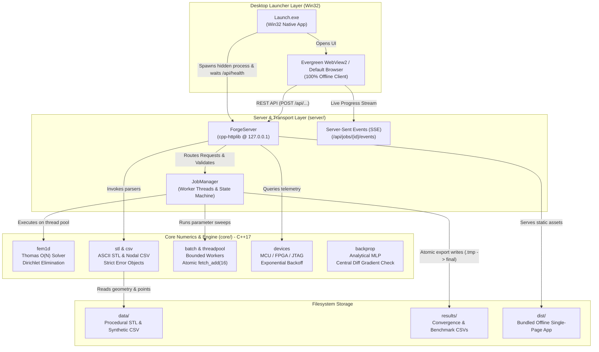
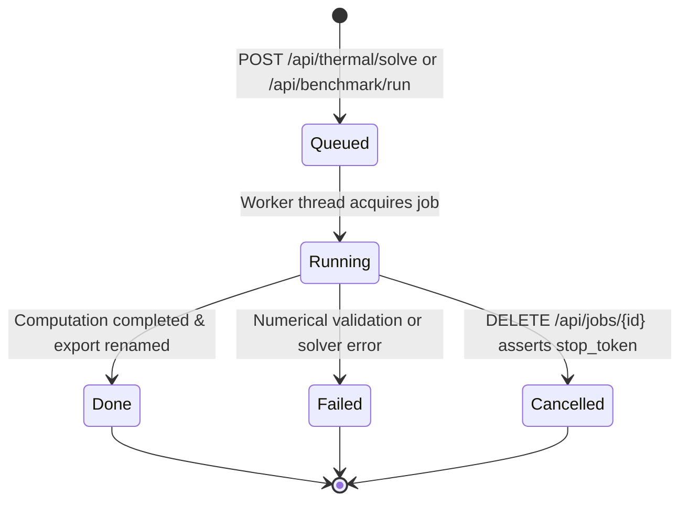

# Forge Engineering Workbench: System Architecture & Design

> [!NOTE]
> This document details the technical architecture, component relationships, data flow, memory ownership, and threading models of **Forge**, engineered for the selection assignment.

---

## 1. System Overview & Component Decomposition

Forge is partitioned into four decoupled layers, enforcing strict separation of concerns, deterministic numerics, and high responsiveness:



---

## 2. Architectural Boundaries & Compliance

### 2.1 Hard Rule 5: Core Numerics Isolation
To guarantee modularity and numerical testability:
- **`src/core/` contains ZERO HTTP, JSON, or UI headers.**
- Core components depend strictly on standard C++17 library headers (`<vector>`, `<string>`, `<variant>`, `<thread>`, `<atomic>`, `<chrono>`, `<cmath>`, `<filesystem>`).
- All JSON serialization, deserialization, REST HTTP routing, and SSE event streaming live strictly in `src/server/`.
- Core never throws exceptions across module boundaries; every function returns `std::variant<Result, Error>` or a valid aggregate.

### 2.2 Error Handling Strategy (Hard Rule 8)
Every parser and numerical function returns a structured error object containing exact failure diagnostics:

```cpp
struct Error {
    std::string message;
    size_t line_number{0};
    std::string actionable_fix;
};
```
- **Line Numbers**: Parsers track physical source line indices (1-indexed).
- **Actionable Guidance**: Every error conveys what failed and how the operator or upstream caller can resolve it (e.g. *"Binary STL not supported, export ASCII"*, *"Duplicate node_id: 1 on line 4"*).
- **No Boundary Throwing**: Errors are returned in `std::variant<T, Error>`. The server translates errors to HTTP 400/404 JSON responses without crashing or uncaught exceptions.

---

## 3. Runtime Job Model & Concurrency

### 3.1 Asynchronous Job State Machine
Long-running computations (thermal solves, convergence studies, parameter sweep benchmarks) are decoupled from the HTTP event loop via the `JobManager`:



- **Thread-Safe States**: Job states are managed via `std::atomic<JobState>`.
- **Live Progress via SSE**: The client opens an EventSource stream at `/api/jobs/{id}/events`. The worker thread atomically updates `job->progress` ($0.0 \dots 1.0$), pushing real-time status frames to the frontend without HTTP polling.
- **Atomic File Exports (Decision 009)**: Export files are written to `results/<name>.tmp` and renamed atomically via `std::filesystem::rename` upon successful job completion. If cancelled via `DELETE /api/jobs/{id}`, the worker observes `stop_token.load() == true` within 50 ms and removes the temporary file, ensuring zero corrupted or partial files on disk.

### 3.2 Thread Pool & Parallel Scheduling (Task D)
To prevent thread explosion and handle parameter sweep batches efficiently:
- **Bounded Worker Pool (`src/core/threadpool.hpp`)**: The thread pool spawns exactly $p$ worker threads (bounded by `std::thread::hardware_concurrency()`). Threads remain resident and wait on a condition variable when idle.
- **Dynamic Chunking**: Rather than fine-grained locking or static partitioning, workers dynamically claim chunks of 16 problems using an atomic counter:
  ```cpp
  const size_t start = next_idx.fetch_add(chunk_size, std::memory_order_relaxed);
  ```
- **Zero Race Conditions**: Each worker writes results to non-overlapping indices in a pre-allocated output vector `results[i]`, eliminating mutex locks during the numerical solve.
- **Deterministic Bitwise Equivalence**: Because linear equation solutions on each problem instance $i$ are deterministic and independent, parallel batch solves match serial single-threaded solves to $\le 10^{-8}\ ^\circ\text{C}$ (experimentally verified bitwise identical).

---

## 4. Desktop Launcher & Workstation Integration (Task A)

### 4.1 Native Windows 11 Launcher Lifecycle (`src/launcher/main.cpp`)
Double-clicking `Launch.exe` executes a native Win32 entry point that orchestrates the application without external batch scripts or terminal dependencies:

1. **Free Port Allocation**: The launcher queries the OS TCP stack by creating a temporary socket on `127.0.0.1:0`, reading the assigned ephemeral port with `getsockname()`, and closing it.
2. **Hidden Server Spawning**: The launcher locates `forge_server.exe` and spawns it using `CreateProcessW` with `CREATE_NO_WINDOW` and `SW_HIDE`, passing `--port <port>`.
3. **Health Check Synchronization**: The launcher polls `GET http://127.0.0.1:<port>/api/health` until HTTP 200 OK is returned (typically $< 250\ \text{ms}$).
4. **Browser Launch**: The launcher opens `http://127.0.0.1:<port>/` in the default system browser via `ShellExecuteW`.
5. **Controller Window**: Displays a clean dark-mode control window titled *"Forge Engineering Workbench - Windows 11 x64"*.
6. **Graceful Teardown**: Upon window closure (`WM_CLOSE`/`WM_DESTROY`), the launcher issues `POST /api/shutdown` and calls `WaitForSingleObject()` / `TerminateProcess()` on the server process, guaranteeing no orphaned background processes remain.

---

## 5. Offline-First Bundling & Security

### 5.1 Hard Rule 6 Compliance
- **Zero External CDNs**: All stylesheets, JavaScript bundles, Three.js modules, and uPlot libraries are pre-compiled into `dist/`.
- **Bundled Typography**: WOFF2 binaries for **Inter** (UI) and **JetBrains Mono** (numerics) are bundled locally in `src/frontend/src/assets/fonts/` with `font-display: swap`.
- **Localhost Binding**: All networking is strictly bound to `127.0.0.1`. The application makes zero external HTTP requests, sends zero telemetry off-box, and operates completely offline.
