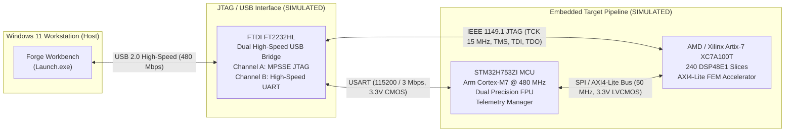

# Embedded Hardware Subsystem Architecture & Simulation Specification

> [!IMPORTANT]
> **SIMULATED SUBSYSTEM (Rule 3 Compliance)**:
> In accordance with Hard Rule 3 of the project specification, the embedded devices subsystem documented here is **SIMULATED**. All backend core adapters return `"simulated": true` in telemetry payloads, and all user interface views visibly designate these components as simulated mocks. No physical hardware connection is required at runtime.

---

## 1. System Interconnect Architecture

The Forge hardware architecture integrates a high-performance heterogeneous embedded processing pipeline designed for thermal telemetry acquisition, hardware-accelerated finite element calculations, and in-system programming/diagnostics.



### Architecture SVG Diagram
<svg xmlns="http://www.w3.org/2000/svg" viewBox="0 0 880 260" width="100%" height="260" style="background:#070b19; border-radius:8px; border:1px solid #27325f;">
  <!-- Host Box -->
  <rect x="20" y="30" width="180" height="200" rx="8" fill="#121a33" stroke="#27325f" stroke-width="2"/>
  <text x="110" y="60" fill="#e9ecff" font-family="sans-serif" font-weight="bold" font-size="14" text-anchor="middle">Host Workstation</text>
  <rect x="35" y="80" width="150" height="60" rx="4" fill="#1a2447" stroke="#06b6d4" stroke-width="1"/>
  <text x="110" y="105" fill="#06b6d4" font-family="sans-serif" font-size="12" font-weight="bold" text-anchor="middle">Forge Workbench</text>
  <text x="110" y="125" fill="#8c95d6" font-family="monospace" font-size="11" text-anchor="middle">Launch.exe</text>
  <text x="110" y="190" fill="#34d399" font-family="monospace" font-size="11" text-anchor="middle">Win32 + WebView2</text>

  <!-- USB Link -->
  <line x1="200" y1="110" x2="260" y2="110" stroke="#06b6d4" stroke-width="2"/>
  <text x="230" y="102" fill="#8c95d6" font-family="monospace" font-size="9" text-anchor="middle">USB 2.0</text>

  <!-- FT2232 Box -->
  <rect x="260" y="30" width="180" height="200" rx="8" fill="#121a33" stroke="#f59e0b" stroke-width="1.5" stroke-dasharray="4,4"/>
  <rect x="270" y="40" width="70" height="18" rx="3" fill="#f59e0b" opacity="0.2"/>
  <text x="305" y="53" fill="#f59e0b" font-family="monospace" font-size="9" font-weight="bold" text-anchor="middle">SIMULATED</text>
  <text x="350" y="80" fill="#e9ecff" font-family="sans-serif" font-weight="bold" font-size="13" text-anchor="middle">JTAG / Comm Bridge</text>
  <text x="350" y="100" fill="#06b6d4" font-family="monospace" font-size="11" text-anchor="middle">FTDI FT2232HL</text>
  <text x="350" y="130" fill="#8c95d6" font-family="sans-serif" font-size="11" text-anchor="middle">Ch A: JTAG (15 MHz)</text>
  <text x="350" y="150" fill="#8c95d6" font-family="sans-serif" font-size="11" text-anchor="middle">Ch B: USART (3.3V)</text>
  <text x="350" y="180" fill="#e9ecff" font-family="monospace" font-size="10" text-anchor="middle">VREF: 3.3V | USB: 5.0V</text>

  <!-- Interconnects -->
  <line x1="440" y1="95" x2="490" y2="95" stroke="#6366f1" stroke-width="2"/>
  <text x="465" y="88" fill="#8c95d6" font-family="monospace" font-size="9" text-anchor="middle">USART</text>

  <line x1="440" y1="165" x2="490" y2="165" stroke="#8b5cf6" stroke-width="2"/>
  <text x="465" y="158" fill="#8c95d6" font-family="monospace" font-size="9" text-anchor="middle">JTAG</text>

  <!-- MCU Box -->
  <rect x="490" y="30" width="170" height="95" rx="8" fill="#121a33" stroke="#f59e0b" stroke-width="1.5" stroke-dasharray="4,4"/>
  <rect x="500" y="38" width="65" height="16" rx="3" fill="#f59e0b" opacity="0.2"/>
  <text x="532" y="50" fill="#f59e0b" font-family="monospace" font-size="9" font-weight="bold" text-anchor="middle">SIMULATED</text>
  <text x="575" y="68" fill="#e9ecff" font-family="sans-serif" font-weight="bold" font-size="12" text-anchor="middle">Telemetry MCU</text>
  <text x="575" y="86" fill="#38bdf8" font-family="monospace" font-size="11" text-anchor="middle">STM32H753ZI</text>
  <text x="575" y="105" fill="#8c95d6" font-family="sans-serif" font-size="10" text-anchor="middle">Cortex-M7 @ 480 MHz</text>

  <!-- FPGA Box -->
  <rect x="490" y="135" width="170" height="95" rx="8" fill="#121a33" stroke="#f59e0b" stroke-width="1.5" stroke-dasharray="4,4"/>
  <rect x="500" y="143" width="65" height="16" rx="3" fill="#f59e0b" opacity="0.2"/>
  <text x="532" y="155" fill="#f59e0b" font-family="monospace" font-size="9" font-weight="bold" text-anchor="middle">SIMULATED</text>
  <text x="575" y="173" fill="#e9ecff" font-family="sans-serif" font-weight="bold" font-size="12" text-anchor="middle">FEM Accelerator</text>
  <text x="575" y="191" fill="#38bdf8" font-family="monospace" font-size="11" text-anchor="middle">XC7A100T-2FTG256C</text>
  <text x="575" y="210" fill="#8c95d6" font-family="sans-serif" font-size="10" text-anchor="middle">Artix-7 (240 DSPs)</text>

  <!-- MCU to FPGA SPI -->
  <line x1="575" y1="125" x2="575" y2="135" stroke="#34d399" stroke-width="2"/>
  <text x="605" y="132" fill="#34d399" font-family="monospace" font-size="9">SPI/AXI</text>

  <!-- Power Domains Legend -->
  <rect x="680" y="30" width="180" height="200" rx="8" fill="#121a33" stroke="#27325f" stroke-width="2"/>
  <text x="770" y="55" fill="#e9ecff" font-family="sans-serif" font-weight="bold" font-size="13" text-anchor="middle">Power & Signal Rails</text>
  <circle cx="700" cy="85" r="5" fill="#f43f5e"/>
  <text x="715" y="89" fill="#e9ecff" font-family="monospace" font-size="11">VBUS: 5.0 V (USB)</text>
  <circle cx="700" cy="115" r="5" fill="#38bdf8"/>
  <text x="715" y="119" fill="#e9ecff" font-family="monospace" font-size="11">VDD: 3.3 V (CMOS)</text>
  <circle cx="700" cy="145" r="5" fill="#a855f7"/>
  <text x="715" y="149" fill="#e9ecff" font-family="monospace" font-size="11">VCCAUX: 1.8 V</text>
  <circle cx="700" cy="175" r="5" fill="#34d399"/>
  <text x="715" y="179" fill="#e9ecff" font-family="monospace" font-size="11">VCCINT: 1.0 V (Core)</text>
  <text x="770" y="212" fill="#8c95d6" font-family="sans-serif" font-size="10" text-anchor="middle">Common GND Reference</text>
</svg>

---

## 2. Hardware Interface & Electrical Specification

| Device Channel | Interface Type | Pin Signals | Voltage Levels | Logic Standard | Pull-Up / Termination | Max Frequency / Baud |
| :--- | :--- | :--- | :--- | :--- | :--- | :--- |
| **MCU Debug / UART** | Asynchronous Serial | `TXD` (PA9), `RXD` (PA10), `GND` | $V_{DD} = 3.3\ \text{V} \pm 5\%$ | 3.3V LVCMOS | Internal weak pull-up ($40\ \text{k}\Omega$) | $3.0\ \text{Mbps}$ |
| **FPGA JTAG** | IEEE 1149.1 4-wire | `TCK`, `TMS`, `TDI`, `TDO`, `nTRST` | $V_{\text{CCO\_0}} = 3.3\ \text{V}$ | LVCMOS33 | `TMS`/`TDI`: $4.7\ \text{k}\Omega$ pull-up; `TCK`: $10\ \text{k}\Omega$ pull-down | $15.0\ \text{MHz}$ |
| **MCU-FPGA Coprocessor** | Synchronous SPI | `SCK`, `MOSI`, `MISO`, `nCS` | $3.3\ \text{V} \text{ / } 1.8\ \text{V}$ level-shifted | LVCMOS33 / LVCMOS18 | Source series damping $22\ \Omega$ | $50.0\ \text{MHz}$ |
| **FPGA Core Power** | Internal Supply | `VCCINT` | $1.00\ \text{V} \pm 3\%$ | DC Internal Rail | Low-ESR ceramic decoupling array | DC ($< 1.5\ \text{A}$ max) |
| **FPGA Aux Power** | Auxiliary Supply | `VCCAUX` | $1.80\ \text{V} \pm 5\%$ | DC Rail | Ferrite bead filtered | DC ($< 250\ \text{mA}$) |

---

## 3. Real Hardware Datasheet Citations

All simulated device behaviors, voltages, operating frequencies, and register behaviors are directly modelled after commercial semiconductor datasheets:

1. **STMicroelectronics STM32H753ZI**:
   - *Title*: STM32H753xI Data sheet - 32-bit Arm Cortex-M7 480MHz MCUs, 2MB Flash, 1MB RAM, 46 communication interfaces, crypto.
   - *Document*: STMicroelectronics **DS13312 Rev 3** (November 2021).
   - *Citations*: Section 6.3.2 "Operating conditions at power-up / power-down" (Table 23: $V_{DD} = 1.62\ \text{to } 3.6\ \text{V}$); Section 6.3.14 "I/O port characteristics" ($V_{OH} \ge 2.4\ \text{V}$, $V_{OL} \le 0.4\ \text{V}$ at $8\ \text{mA}$).
   - *Reference Manual*: STMicroelectronics **RM0433 Rev 7** (November 2021), Chapter 37 "Universal synchronous asynchronous receiver transmitter (USART)".

2. **AMD / Xilinx Artix-7 XC7A100T-2FTG256C**:
   - *Title*: Artix-7 FPGAs Data Sheet: DC and AC Switching Characteristics.
   - *Document*: Xilinx **DS181 (v1.25)** (July 2, 2018).
   - *Citations*: Table 1 "Absolute Maximum Ratings" ($V_{\text{CCINT}} = -0.5\ \text{to } 1.1\ \text{V}$, $V_{\text{CCAUX}} = -0.5\ \text{to } 2.0\ \text{V}$); Table 2 "Recommended Operating Conditions" ($V_{\text{CCINT}} = 0.95\ \text{to } 1.05\ \text{V}$ for $-2$ speed grade, nominal $1.00\ \text{V}$).
   - *Configuration Guide*: Xilinx **UG470 (v1.13.1)** (November 30, 2018), Chapter 2 "Configuration Details: IEEE 1149.1 JTAG Boundary Scan" (IDCODE `0x03631093` for XC7A100T).

3. **FTDI Chip FT2232HL Dual High-Speed USB to Multipurpose UART/FIFO IC**:
   - *Title*: Future Technology Devices International Ltd. FT2232H Dual High Speed USB to Multipurpose UART/FIFO IC Datasheet.
   - *Document*: FTDI Chip **DS_FT2232H (Version 2.6)** (2021).
   - *Citations*: Section 4.3 "DC Characteristics" ($V_{\text{CORE}} = 1.8\ \text{V}$, $V_{\text{CCIO}} = 3.3\ \text{V}$, $I_{\text{CC\_OPERATING}} \approx 70\ \text{mA}$); Section 4.5 "MPSSE Mode JTAG Timing" (Max $T_{\text{CK}} = 30\ \text{MHz}$).

---

## 4. Fault Injection & Exponential Backoff Recovery Protocol

The core embedded adapter implements automated link recovery with a standardized 3-stage exponential backoff schedule when communication timeouts or packet CRC checksum errors occur.

### Recovery Sequence Timeline

```text
Host Request ──> [TIMEOUT / NAK]
                      │
                      ├── Attempt 1: Backoff 200 ms ──> Retry 1 ──> [FAILED]
                      │
                      ├── Attempt 2: Backoff 400 ms ──> Retry 2 ──> [RESTORED] ──> Normal Telemetry
                      │
                      └── Attempt 3: Backoff 800 ms ──> Retry 3 ──> [EXHAUSTED] ──> Status: FAULTED
```

1. **Failure Detection**: If the target device fails to respond within $50\ \text{ms}$, or if `inject_fault(fail_count)` has been asserted, the adapter marks the link state as `Degraded` or `Recovering`.
2. **Backoff Schedule**:
   - **Retry 1**: Delay $200\ \text{ms}$. If `remaining_failures == 0`, transition to `Connected`.
   - **Retry 2**: Delay $400\ \text{ms}$. If `remaining_failures == 0`, transition to `Connected`.
   - **Retry 3**: Delay $800\ \text{ms}$. If `remaining_failures == 0`, transition to `Connected`.
3. **Exhaustion Handling**:
   - If the link fails across all 3 retries (total backoff delay $= 1400\ \text{ms}$), the adapter transitions to `Faulted`.
   - Subsequent calls return structured error:
     ```json
     {
       "field": "telemetry",
       "message": "Device timeout: all 3 recovery retries exhausted",
       "hint": "Execute reset command via /api/devices/{type}/reset",
       "simulated": true
     }
     ```
   - Recovery is achieved by sending a software re-synchronization frame via `POST /api/devices/{type}/reset`.
